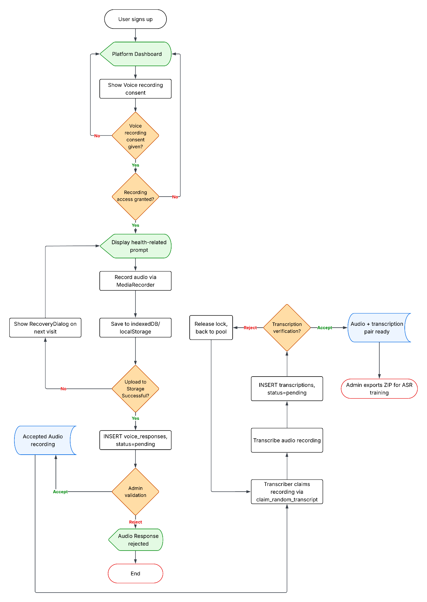
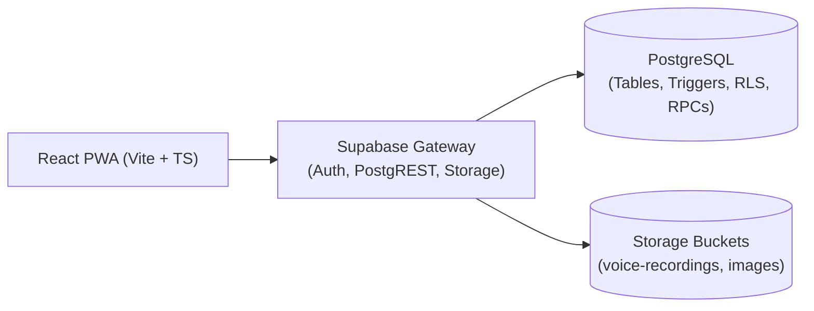
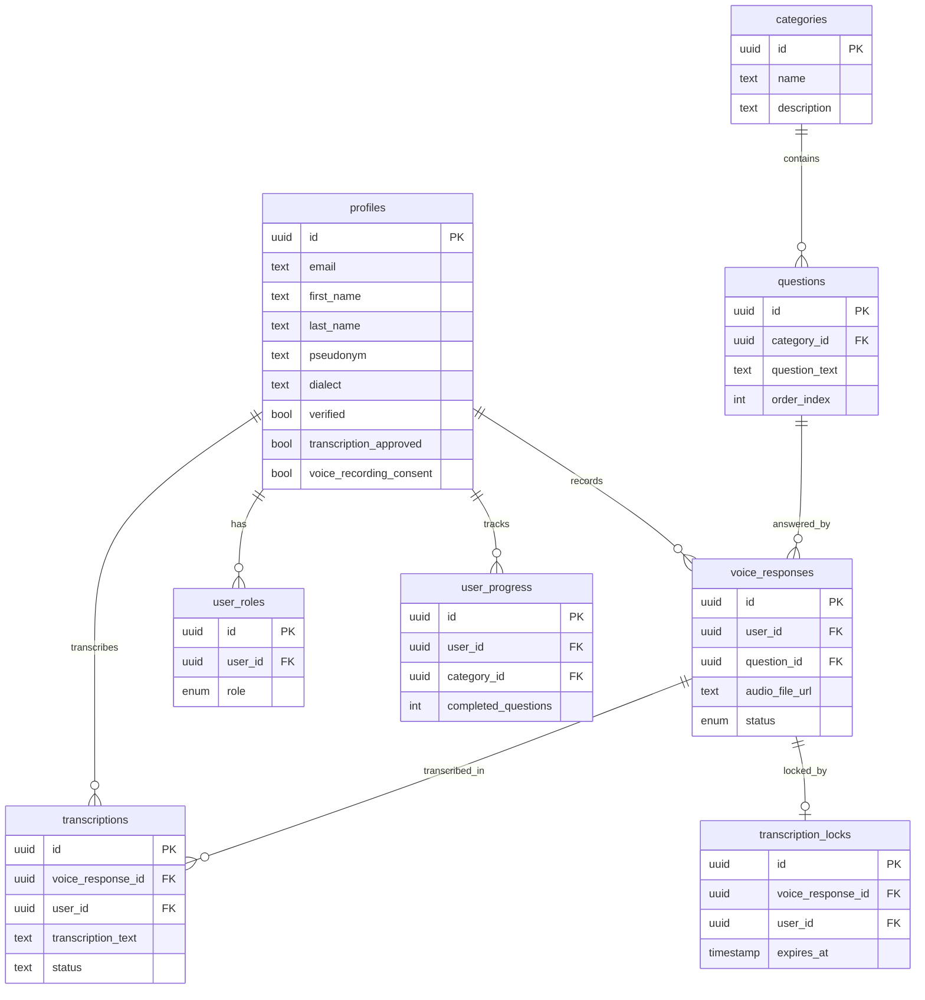
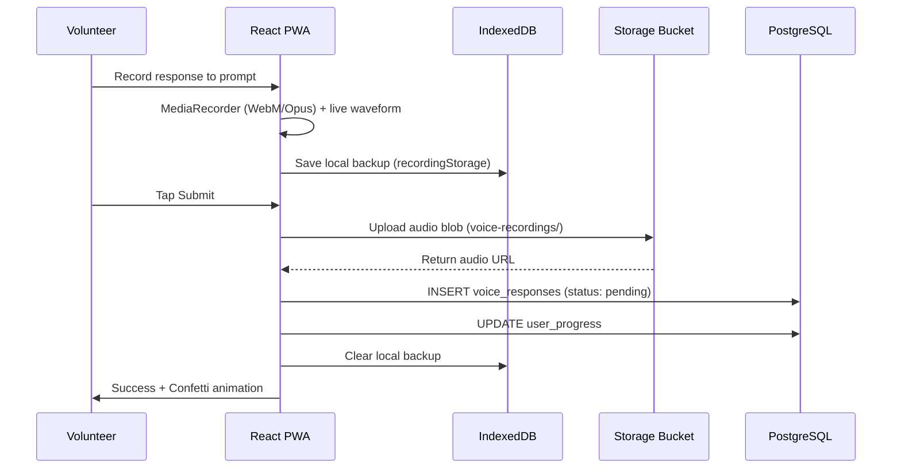
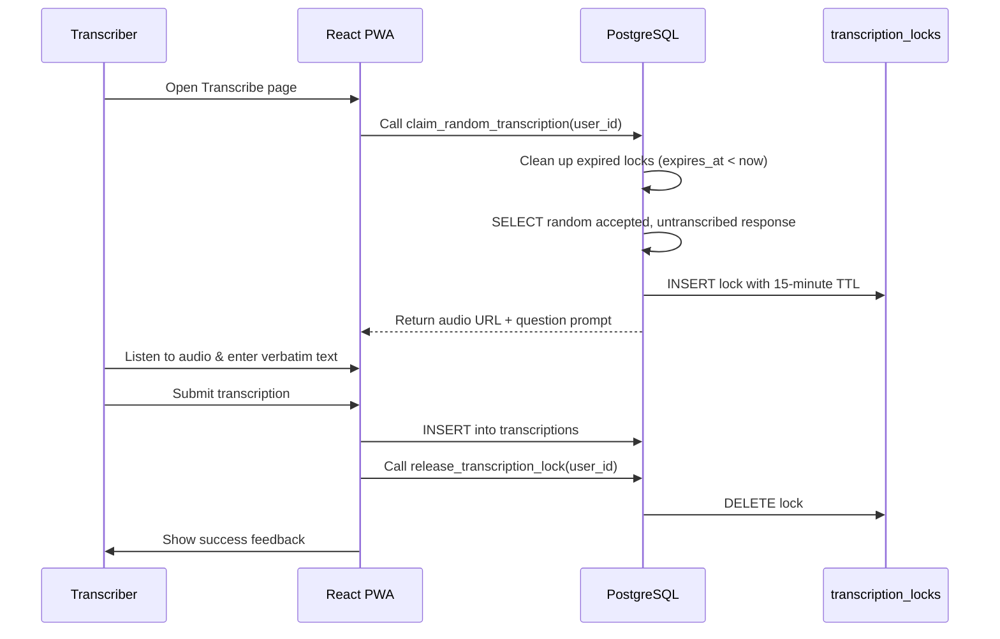
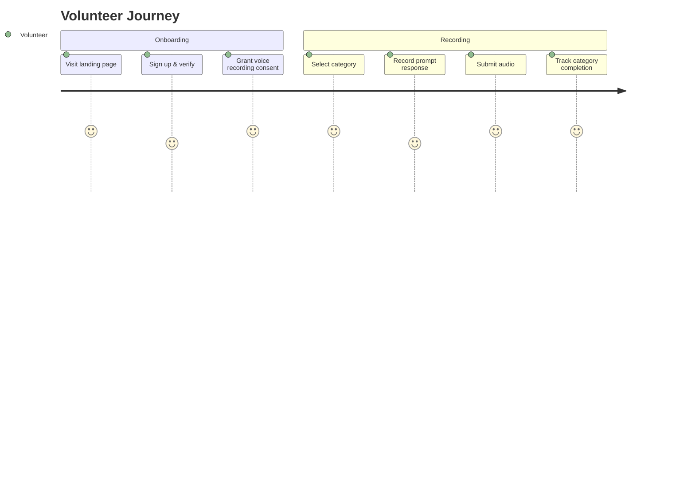
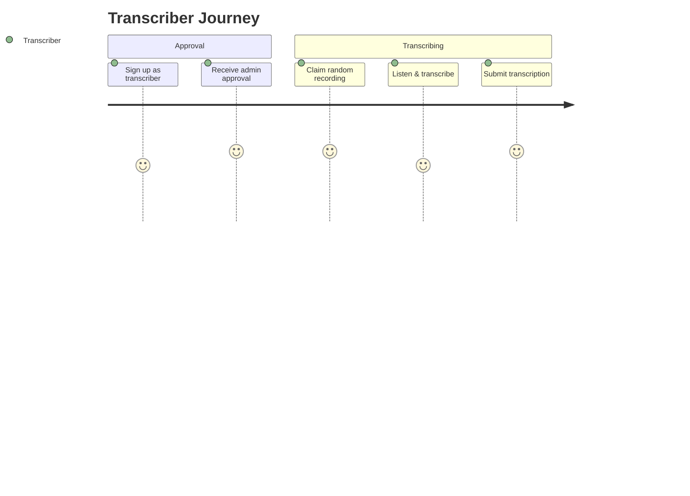
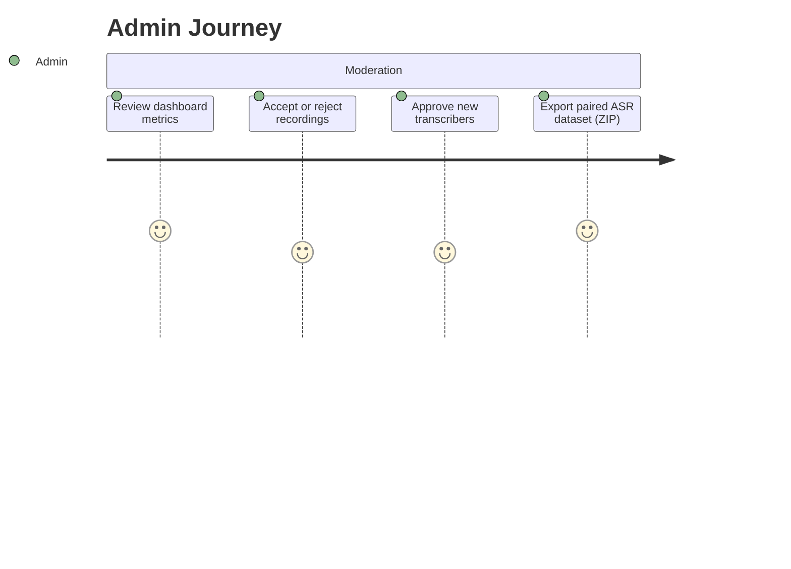

# JasinaHub

> A speech and text data collection platform for low-resource African languages. Built with a focus on user experience, accessibility, and robust user and data management. The platform enables community-driven data collection by providing an accessible web interface where volunteers can record naturally elicited responses or read-speech responses to supplied prompts in their native languages. The transcription workflow allows for the transcription of validated recordings, producing paired audio–transcription datasets suitable for downstream machine learning tasks.

[](https://www.typescriptlang.org/)
[](https://react.dev/)
[](https://vitejs.dev/)
[](https://tailwindcss.com/)
[](https://supabase.com/)
[](LICENSE)

[**Live Demo**](https://jasinahub.vercel.app) • [**Quick Start**](#quick-start) • [**Deployment**](#deployment) • [**Database Setup**](#3-set-up-database-supabase-cloud--no-docker) • [**Architecture**](docs/ARCHITECTURE.md) • [**Documentation**](#documentation-index)

---

## How It Works

The platform operates across three integrated user roles:

```
  ┌────────────────────────┐      ┌────────────────────────┐      ┌────────────────────────┐
  │  1. Record             │      │  2. Transcribe         │      │  3. Curate & Export    │
  │  (Volunteers)          │ ───► │  (Transcribers)        │ ───► │  (Administrators)      │
  │  Answer prompts        │      │  Listen to audio and   │      │  Review quality,       │
  │  in local languages    │      │  provide verbatim      │      │  accept/reject records,│
  │  via mobile or PWA.    │      │  transcriptions.       │      │  and export ZIPs.      │
  └────────────────────────┘      └────────────────────────┘      └────────────────────────┘
```

<p align="center">
  
</p>

---

## Tech Stack

| Layer | Technologies |
|---|---|
| **Frontend** | React 18, TypeScript, Vite, Tailwind CSS, shadcn/ui, React Router v6, TanStack Query, Recharts |
| **Backend & Database** | PostgreSQL, Supabase Auth, Row-Level Security (RLS), Supabase Storage, Deno Edge Functions |
| **Mobile & Offline** | Progressive Web App (PWA), Service Workers, IndexedDB local fallback queue |

---

## Quick Start

### 1. Prerequisites (Install Node.js)

JasinaHub requires **Node.js 18+** (or Bun 1.x) and **npm**. Follow the installation instructions for your operating system:

#### Windows
- **Installer (Recommended):** Download and run the Windows Installer (.msi) from [nodejs.org](https://nodejs.org/).
- **Winget:** Run the following command in PowerShell:
  ```powershell
  winget install OpenJS.NodeJS.LTS
  ```

#### macOS
- **Installer (Recommended):** Download and run the macOS Installer (.pkg) from [nodejs.org](https://nodejs.org/).
- **Homebrew:**
  ```bash
  brew install node
  ```

#### Linux
- **Ubuntu / Debian:**
  ```bash
  curl -fsSL https://deb.nodesource.com/setup_20.x | sudo -E bash -
  sudo apt-get install -y nodejs
  ```
- **Fedora / RHEL:**
  ```bash
  sudo dnf install -y nodejs npm
  ```
- **Arch Linux:**
  ```bash
  sudo pacman -S nodejs npm
  ```

#### Verify Installation
Confirm that Node.js and npm are installed:
```bash
node -v   # Expected: v18.0.0 or higher
npm -v    # Expected: v9.0.0 or higher
```

### 2. Fork & Clone Your Repository

To use, customize, or deploy JasinaHub, work from your own GitHub fork:

1. Navigate to [github.com/DeKUT-DSAIL/JasinaHub](https://github.com/DeKUT-DSAIL/JasinaHub).
2. Click the **Fork** button (top-right) to create an independent copy under your personal GitHub account or organization.
3. Clone your forked repository to your local machine:

```bash
# Replace <your-username> with your GitHub username
git clone https://github.com/<your-username>/JasinaHub.git
cd JasinaHub

# Install dependencies
npm install
```

4. (Recommended) Configure the original parent repository as an `upstream` remote so you can sync future updates:

```bash
git remote add upstream https://github.com/DeKUT-DSAIL/JasinaHub.git
```

All your local commits and pushes (`git push origin main`) will publish directly to your personal fork without affecting the parent repository.

### 3. Set Up Database (Supabase Cloud — No Docker)

1. Create a free project at [supabase.com/dashboard](https://supabase.com/dashboard).
2. Open the **SQL Editor** (`>_`) in your Supabase dashboard and click **New query**.
3. Open [`supabase/setup_complete.sql`](supabase/setup_complete.sql) from this repository, copy its contents, paste into the SQL Editor, and click **Run**.

<details>
<summary><b>View Database Components Initialized by the Script</b></summary>

The one-click setup script is fully idempotent and provisions the complete backend:
- **Custom Enums:** `app_role` (`admin`, `user`) and `response_status` (`pending`, `accepted`, `rejected`).
- **Core Relational Tables:** `profiles`, `user_roles`, `categories`, `questions`, `voice_responses`, `transcriptions`, `transcription_locks`, `user_progress`, `user_activity_logs`, `feedback_questions`, `feedback_submissions`, `feedback_answers`, `password_reset_codes`.
- **Database Triggers:** Automated profile provisioning hook on `auth.users` (`handle_new_user`) and anonymous pseudonym generator (`set_profile_pseudonym`).
- **Stored Procedures (RPCs):** `has_role`, atomic locking procedure `claim_random_transcription`, `release_transcription_lock`, `get_question_counts`, `get_admin_chart_data`, and `get_transcription_stats`.
- **Row-Level Security (RLS) & Grants:** Enforced access boundaries with grants to `authenticated`, `anon`, and `service_role`.
- **Storage Buckets:** `voice-recordings` (public audio streaming) and `images` (question illustrations).
- **Starter Seed Data:** Default categories (*General Health*, *Nutrition*, *Maternal Health*), sample health prompts, and rating questions.

</details>

### 4. Configure Environment

Copy the example environment file:

```bash
cp .env.example .env
```

Retrieve your **Project URL** and **anon/public key** from your Supabase Dashboard (**Project Settings → API**), and add them to `.env`:

```env
VITE_SUPABASE_URL="https://your-project-id.supabase.co"
VITE_SUPABASE_PUBLISHABLE_KEY="your-anon-public-key"
VITE_SUPABASE_PROJECT_ID="your-project-id"
```

### 5. Run the Dev Server

```bash
npm run dev
```

Open **`http://localhost:8080`** in your browser.

### 6. Create Your First Admin Account

1. Register an account at `http://localhost:8080/signup`.
2. In your Supabase **SQL Editor**, run the following query to promote your account:

```sql
UPDATE public.profiles SET verified = true WHERE email = 'your-email@example.com';

INSERT INTO public.user_roles (user_id, role)
SELECT id, 'admin'::app_role FROM auth.users WHERE email = 'your-email@example.com'
ON CONFLICT (user_id, role) DO NOTHING;
```

3. Sign in to access the **Admin Dashboard** (`/admin`).

### 7. Verify Installation

In the app, navigate to **Admin Panel → Tests** tab and click **Run all tests**. All test suites (Smoke, Auth, RLS, Storage, and RPC) will run automated checks and display green checkmarks.

---

## Deployment

Once your application is running locally and your Supabase project is configured, you can deploy JasinaHub to static hosting platforms such as Vercel or Netlify.

### 1. Pre-Deployment Preparation

- Ensure all local code changes are committed and pushed to your **forked** GitHub repository (`https://github.com/<your-username>/JasinaHub`).
- Verify that your Supabase database has been initialized using [`supabase/setup_complete.sql`](supabase/setup_complete.sql).
- Have your Supabase credentials ready (`VITE_SUPABASE_URL`, `VITE_SUPABASE_PUBLISHABLE_KEY`, and `VITE_SUPABASE_PROJECT_ID`).

### 2. Deploying to Vercel

Vercel provides native support for Vite applications. Single-page application rewrites are pre-configured in `vercel.json` to prevent 404 errors on page reload.

#### Using the Vercel Dashboard

1. Sign in to [vercel.com](https://vercel.com) and click **Add New... > Project**.
2. Select your **forked** `JasinaHub` GitHub repository (`<your-username>/JasinaHub`).
3. Configure the build settings (Vite is automatically detected):
   - **Framework Preset:** Vite
   - **Build Command:** `npm run build`
   - **Output Directory:** `dist`
4. Expand the **Environment Variables** section and add the following keys:
   - `VITE_SUPABASE_URL`: Your Supabase Project URL
   - `VITE_SUPABASE_PUBLISHABLE_KEY`: Your Supabase anon public API key
   - `VITE_SUPABASE_PROJECT_ID`: Your Supabase project reference ID
5. Click **Deploy**.

Deploying from your fork ensures that Vercel automatically deploys updates whenever you push commits to your repository (`origin`), without affecting the parent repository.

#### Using the Vercel CLI (Alternative)

```bash
npm install -g vercel
vercel
```

Follow the interactive prompts and supply the environment variables in project settings.

### 3. Deploying to Netlify

Netlify single-page routing is pre-configured via `public/_redirects` to route all page requests to `/index.html`.

#### Using the Netlify Dashboard

1. Sign in to [netlify.com](https://netlify.com) and click **Add new site > Import an existing project**.
2. Connect to your Git provider and select your **forked** `JasinaHub` repository.
3. Configure the build and deploy settings:
   - **Base directory:** Leave blank
   - **Build command:** `npm run build`
   - **Publish directory:** `dist`
4. Under **Environment variables**, click **Add a variable** and define:
   - `VITE_SUPABASE_URL`
   - `VITE_SUPABASE_PUBLISHABLE_KEY`
   - `VITE_SUPABASE_PROJECT_ID`
5. Click **Deploy JasinaHub**.

Any subsequent commits pushed to your fork's production branch will trigger automated Netlify deployments.

#### Using the Netlify CLI (Alternative)

```bash
npm install -g netlify-cli
netlify init
netlify deploy --prod
```

### 4. Supabase Auth Redirect Configuration

After your site is deployed, configure Supabase to handle authentication redirects for your production domain:

1. Open your [Supabase Dashboard](https://supabase.com/dashboard) and select your project.
2. Navigate to **Authentication > URL Configuration**.
3. Set the **Site URL** to your production domain (e.g., `https://your-app.vercel.app` or `https://your-app.netlify.app`).
4. Under **Redirect URLs**, add wildcard patterns for your domain:
   - `https://your-app.vercel.app/**`
   - `https://your-app.netlify.app/**`
5. Click **Save**.

---

## Architecture & Database

JasinaHub uses a 3-tier architecture with PostgREST data APIs, Supabase Auth, and Row-Level Security:



### Technical Deep Dives (Expand to View)

<details>
<summary><b>Relational Entity-Relationship Diagram (ERD)</b></summary>



</details>

<details>
<summary><b>Behavioral Sequence Diagrams (Recording & Lock Pipelines)</b></summary>

#### Voice Recording Pipeline



#### Atomic Transcription Claim Pipeline



</details>

<details>
<summary><b>User Journey Maps (Volunteer, Transcriber, Admin)</b></summary>







</details>

<details>
<summary><b>Core Database Tables & RPC Procedures</b></summary>

#### Primary Tables
- `profiles` — User demographics, consent timestamps, verification flags, and pseudonym (`JSN-XXXX`).
- `user_roles` — Role-based access control (`admin`, `user`).
- `categories` & `questions` — Thematic question groupings and prompts.
- `voice_responses` — Submitted audio files with 3-state moderation (`pending`, `accepted`, `rejected`).
- `transcriptions` & `transcription_locks` — Verbatim text entries and 15-minute concurrency claim locks.
- `user_progress` & `user_activity_logs` — Category completion counters and user audit trails.
- `feedback_*` — Dynamic user experience survey questions, submissions, and answers.

#### Core RPC Stored Procedures
- `claim_random_transcription(_user_id)` — Atomically claims untranscribed recordings with TTL lock.
- `release_transcription_lock(_user_id)` — Releases active claim locks.
- `has_role(_user_id, _role)` — Security definer function used inside RLS policies.
- `get_question_counts()` — Counts responses per question to retire prompts after 3 contributions.
- `get_admin_chart_data()` & `get_transcription_stats()` — Aggregated analytics for admin dashboards.

*For the complete schema, policies, and SQL code, see the [Database Guide](docs/DATABASE.md) and [`supabase/setup_complete.sql`](supabase/setup_complete.sql).*

</details>

---

## Project Structure

```
JasinaHub/
├── src/
│   ├── components/      # Domain components (Admin, Dashboard, Questions, VoiceRecording)
│   ├── hooks/           # Custom hooks (activity tracking, presence, haptics, gestures)
│   ├── integrations/    # Supabase client and auto-generated database types
│   ├── pages/           # Route views (Dashboard, Transcribe, Admin, Profile, Docs)
│   ├── services/        # Audio recorders and storage upload services
│   └── utils/           # Audio processing and IndexedDB offline recovery queue
├── supabase/
│   ├── setup_complete.sql  # 1-click idempotent SQL setup script for Supabase SQL Editor
│   ├── seed.sql            # Default categories and starter prompts
│   ├── migrations/         # Timestamped incremental migration files
│   └── functions/          # Deno Edge Functions (reset-password, migrate-drive-audio)
└── docs/                # Comprehensive architectural and reference documentation
```

---

## Documentation Index

Detailed guides are available in the [`docs/`](docs/) directory:

- [**Quick Start Guide**](QUICKSTART.md) — 5-minute setup overview.
- [**Database & Migrations Guide**](docs/DATABASE.md) — Detailed schema reference, RLS policies, and admin promotion.
- [**Architecture Guide**](docs/ARCHITECTURE.md) — System layers, state management, and offline queue design.
- [**API Reference**](docs/API.md) — PostgREST tables, RPC procedures, and storage buckets.
- [**In-App Testing**](docs/TESTING.md) — Test suites and diagnostic runner instructions.
- [**Deployment Guide**](docs/DEPLOYMENT.md) — Deploying to Vercel, Netlify, and Lovable Cloud.
- [**Troubleshooting**](docs/TROUBLESHOOTING.md) — Solutions for common connection and build errors.
- [**Contributing Guidelines**](CONTRIBUTING.md) — Branch conventions and PR workflows.

---

## Security & Privacy

- **Row-Level Security (RLS)**: Enforced across all tables in PostgreSQL.
- **Explicit Consent**: Consent recorded with UTC timestamp prior to any recording capture.
- **Anonymization**: Public exports identify volunteers by generated pseudonyms (`JSN-XXXX`) rather than personal identifiers.
- **Audio Protection**: Storage buckets use signed URLs and verified bucket policies.

---

## Contributing

Contributions are welcome! Please follow these steps:

1. Fork the repository.
2. Create your feature branch (`git checkout -b feature/amazing-feature`).
3. Commit your changes (`git commit -m 'feat: Add amazing feature'`).
4. Push to the branch (`git push origin feature/amazing-feature`).
5. Open a Pull Request.

---

Centre for Data Science and Artificial Intelligence (DSAIL), DeKUT © 2026
