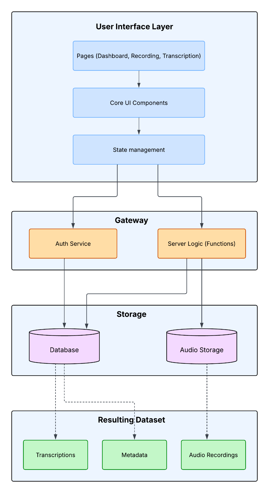
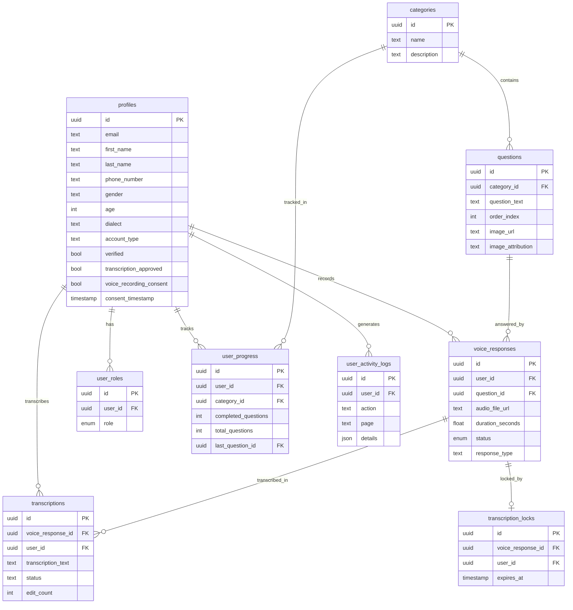
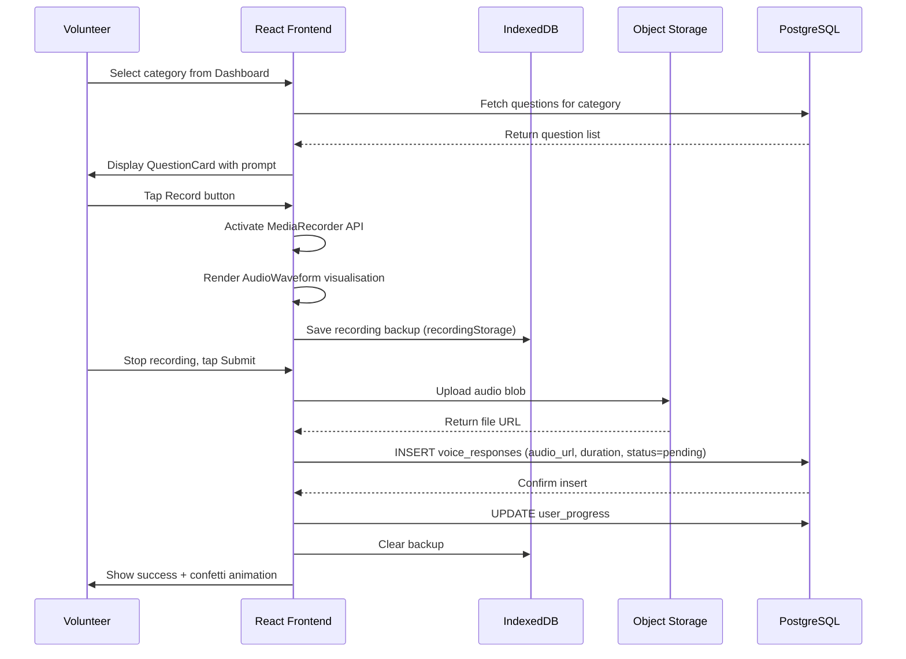
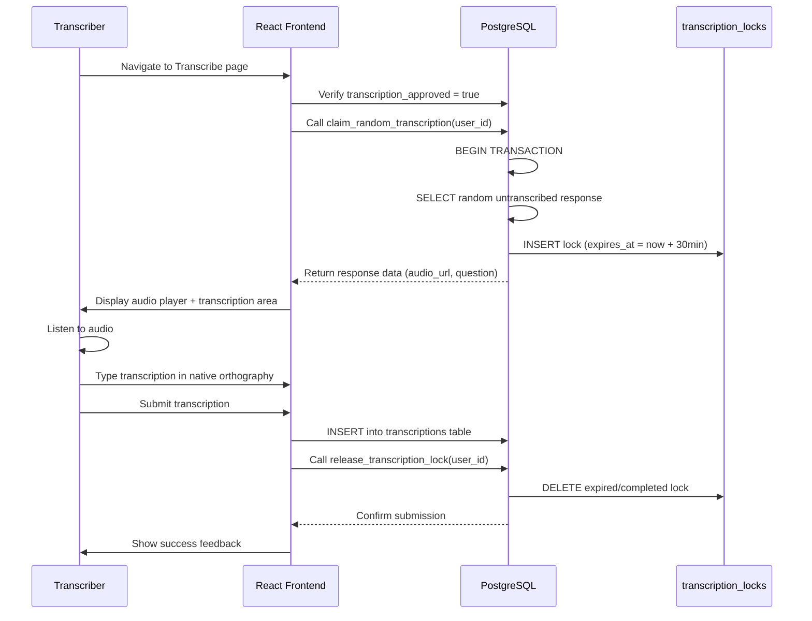
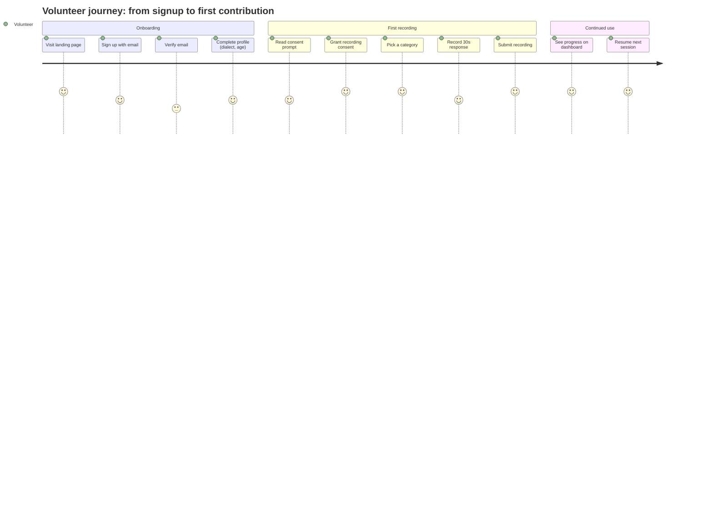
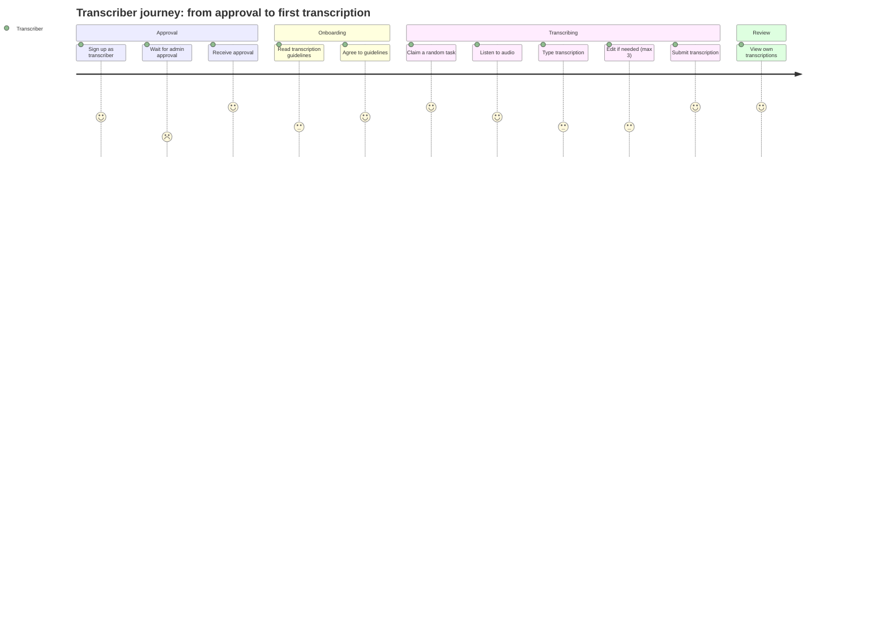
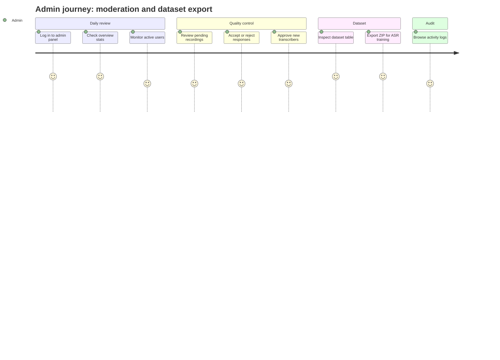
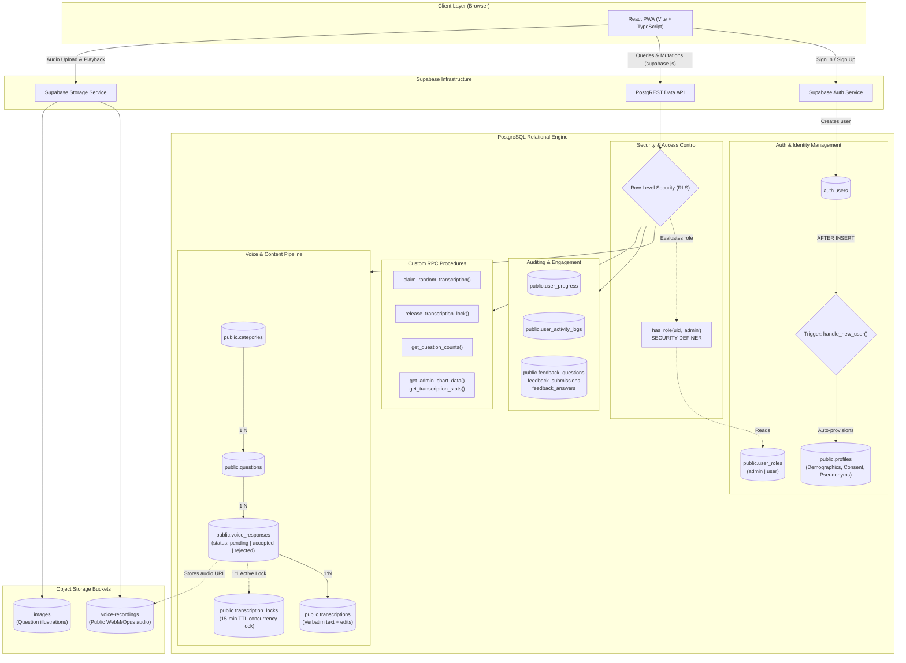

# JasinaHub
A voice data collection platform designed for gathering and managing audio recordings in low-resource African languages at scale. Built with a focus on user experience, accessibility, and robust user and data management.


## Table of Contents

- [Objective](#objective)
- [Functionalities](#functionalities)
- [Tech Stack](#tech-stack)
- [Architecture](#architecture)
- [Diagrams](#diagrams)
  - [High-level architecture](#high-level-architecture)
  - [Structural and data diagrams](#structural-and-data-diagrams)
  - [Behavioral and flow diagrams](#behavioral-and-flow-diagrams)
  - [User-centric diagrams](#user-centric-diagrams)
- [Database Architecture & Schema](#database-architecture--schema)
  - [Database System Architecture](#database-system-architecture)
  - [Entity-Relationship Diagram](#entity-relationship-diagram)
  - [Core Tables Catalog](#core-tables-catalog)
  - [Stored Procedures & RPCs](#stored-procedures--rpcs)
  - [Storage Buckets](#storage-buckets)
- [Getting Started & Installation](#getting-started--installation)
  - [1. Prerequisites](#1-prerequisites)
  - [2. Clone & Local App Installation](#2-clone--local-app-installation)
  - [3. Database Setup (Supabase Cloud — No Docker Required)](#3-database-setup-supabase-cloud--no-docker-required)
  - [4. Environment Variables](#4-environment-variables)
  - [5. Run the Application](#5-run-the-application)
  - [6. Create Your First Admin Account](#6-create-your-first-admin-account)
  - [7. Verifying the Installation](#7-verifying-the-installation)
- [Project Structure](#project-structure)
- [Security](#security)
- [Contributing](#contributing)

## Objective

JasinaHub aims to curate structured, high-quality voice datasets in low-resource African languages for developing Automatic Speech Recognition (ASR) systems. The platform enables community-driven data collection by providing an accessible web interface where volunteers can record spoken responses to health-related prompts in their native languages. Approved transcribers then convert these recordings into text, producing paired audio–transcription datasets suitable for training and evaluating ASR models.

The key goals of the project are:

1. **Scalable voice data collection** — Enable large numbers of volunteers to contribute voice recordings through a simple, mobile-friendly interface.
2. **Community-driven transcription** — Allow approved transcribers to convert audio recordings into text, with quality controls and guidelines for handling dialectal variations and borrowed words.
3. **Dataset curation** — Pair audio recordings with verified transcriptions to produce structured datasets ready for ASR model training.
4. **Quality assurance** — Provide administrators with tools to review, accept, or reject recordings and transcriptions to maintain dataset quality.
5. **Accessibility and inclusivity** — Deliver a mobile-first, offline-resilient experience so that users in areas with limited connectivity can still participate.

## Functionalities

### Voice Recording Module

- **Structured question navigation** — Volunteers respond to categorised health-related prompts organised by topic.
- **In-browser audio capture** — Records audio using the MediaRecorder API in WebM/Opus format directly in the browser.
- **Real-time waveform visualisation** — Displays a live waveform during recording via the `AudioWaveform` component.
- **Cloud upload** — Uploads completed recordings to cloud storage via a serverless edge function.
- **Progress tracking** — Tracks per-category completion so volunteers can resume across sessions, with visual indicators on the dashboard (`SegmentedProgress` component).
- **Consent management** — Records explicit voice recording consent with timestamps before any recording begins (GDPR-compliant).

### Transcription Module

- **Atomic transcription assignment** — Uses a PostgreSQL function (`claim_random_transcription`) with time-limited locks to randomly assign untranscribed recordings to available transcribers, preventing duplicate work.
- **Audio playback** — Transcribers listen to assigned recordings with inline audio controls.
- **Text transcription** — Transcribers type the spoken content in the original language.
- **Edit tracking** — Records edit counts and submission timestamps for each transcription.
- **Transcription guidelines** — Provides comprehensive reference guidelines covering borrowed words, punctuation, and dialectal variations via the `TranscriptionGuidelinesReference` panel.
- **Lock expiry** — Automatically releases assignments via `release_transcription_lock` if a transcriber does not complete within the time limit.

### Administration & Quality Assurance Module

- **Dashboard analytics** — Real-time statistics on total recordings, transcriptions, active users, and per-question response distributions.
- **User management** — Verify user accounts, approve transcribers, and assign roles (admin/user) via dedicated tables.
- **Response review** — Accept or reject submitted recordings with three-state status transitions (pending → accepted / rejected).
- **Transcription oversight** — Monitor transcription progress and quality.
- **Dataset export** — Export paired audio–transcription records as ZIP archives for downstream ASR model training.
- **Active user monitoring** — Real-time presence tracking showing currently online users via the `PresenceTracker` component and `usePresenceTracking` hook.

### User Dashboard

- **Category overview** — Displays all question categories with completion progress per category.
- **My Responses** — View and listen to previously submitted recordings.
- **My Transcriptions** — View completed transcriptions with playback of the associated audio.
- **Profile management** — Update personal details and demographic information.

### Mobile-First Design & Offline Resilience

- **Progressive Web App (PWA)** — Installable on mobile devices with service worker support.
- **Responsive layouts** — Mobile-first design with touch-optimised controls.
- **Haptic feedback** — Native-like vibration feedback on supported devices (`useHapticFeedback` hook).
- **Swipe gestures** — Navigate between questions with swipe gestures (`useSwipeGesture` hook).
- **Pull-to-refresh** — Native-like refresh gesture for mobile users (`usePullToRefresh` hook).
- **Offline recovery** — Audio recordings are persisted to IndexedDB/localStorage before upload. If an upload fails, the `RecoveryDialog` component detects orphaned recordings on the next visit and prompts the user to retry.
- **Network status indicator** — The `OfflineIndicator` component provides real-time connectivity feedback.

### Activity Tracking & Monitoring

- **User activity logging** — Logs page visits, recording submissions, and transcription completions to the `user_activity_logs` table via the `useActivityTracker` hook.
- **Real-time presence** — Tracks concurrent platform usage for administrator visibility.
- **Analytics charts** — Interactive visualisations (built with Recharts) showing recording trends, transcription progress, and user engagement metrics.

## Tech Stack

### Frontend

| Technology | Purpose |
|------------|---------|
| **React 18** | UI library with concurrent features |
| **TypeScript** | Static type checking and enhanced DX |
| **Vite** | Next-generation build tool with HMR |
| **Tailwind CSS** | Utility-first CSS framework |
| **shadcn/ui** | Accessible, customizable component library |
| **React Router v6** | Client-side routing with nested routes |
| **TanStack Query** | Server state management and caching |
| **Recharts** | Charting library for admin analytics |
| **Lucide React** | Modern icon library |

### Backend (Lovable Cloud / Supabase)

| Technology | Purpose |
|------------|---------|
| **PostgreSQL** | Primary database with JSONB support |
| **Row Level Security** | Fine-grained access control at database level |
| **Supabase Auth** | Authentication with email/password |
| **Supabase Realtime** | WebSocket-based presence and live queries |
| **Edge Functions** | Deno-based serverless functions |
| **Storage Buckets** | Secure file storage with access policies |

## Architecture

JasinaHub follows a three-tier architecture: a React single-page application on the client, the Supabase client SDK and PostgREST/Realtime APIs in the middle, and PostgreSQL, Edge Functions, and Storage Buckets on the backend. See the [Container diagram](#container-diagram) below for a detailed view.

### Data Flow

1. **Authentication** — Users authenticate via email/password.
2. **Consent** — Volunteers provide explicit recording consent before proceeding.
3. **Recording** — Audio captured via MediaRecorder API, persisted locally, then uploaded to cloud storage.
4. **Transcription** — Approved transcribers claim recordings, listen, and provide text transcriptions.
5. **Quality Control** — Administrators review and accept/reject recordings and transcriptions.
6. **Dataset Export** — Paired audio–transcription data exported for ASR model training.

## Diagrams

This section provides visual documentation of JasinaHub's architecture and user flows. 

<p align="center">
  
</p>

#### Flowchart

The full journey of a single piece of data, from a volunteer's signup to its appearance in the exported ASR dataset.

<p align="center">
  
</p>

#### Entity-relationship diagram

The full relational model backing the platform: 9 tables covering user identity, content, recordings, transcriptions, locks, roles, progress, and audit logs.



### Behavioral and flow diagrams

#### Sequence diagram — Voice recording pipeline

End-to-end interaction when a volunteer records and submits a response, including offline backup to IndexedDB.



#### Sequence diagram — Atomic transcription claim

How a transcriber is assigned a unique recording without race conditions, using time-limited database locks.



### User-centric diagrams
#### Volunteer



#### Transcriber



#### Admin



## Database Architecture & Schema

JasinaHub leverages PostgreSQL powered by Supabase for its backend, combining relational database structures, automated triggers, pessimistic concurrency locks, Row Level Security (RLS), and object storage buckets.

### Database System Architecture

The following diagram illustrates how the frontend connects to the database components, security barriers, and storage services:



### Core Tables Catalog

| Table | Description | Primary Key | Key Foreign Keys | Access Permissions & Policies |
|---|---|---|---|---|
| `profiles` | Extended profile: first/last name, phone, age, gender, dialect, pseudonym (`JSN-XXXX`), consent flags, and account verification | `id (UUID)` | `id → auth.users.id` | Authenticated users view & edit their own profile; admins can view and verify all profiles |
| `user_roles` | Role assignment table (`admin` or `user`) | `id (UUID)` | `user_id → auth.users.id` | Users can view their own roles; only admins can grant or modify roles |
| `categories` | Thematic prompt groupings (e.g., General Health, Nutrition, Maternal Health) | `id (UUID)` | None | Viewable by all; only admins can create, update, or delete |
| `questions` | Question prompts associated with categories, with optional visual illustrations | `id (UUID)` | `category_id → categories.id` | Viewable by authenticated users; managed exclusively by admins |
| `voice_responses` | Submissions of recorded audio with status (`pending`, `accepted`, `rejected`) | `id (UUID)` | `user_id → auth.users.id`, `question_id → questions.id` | Volunteers view/create their own recordings; transcribers view assigned ones; admins review all |
| `transcriptions` | Text transcriptions of spoken audio with revision count tracking | `id (UUID)` | `voice_response_id → voice_responses.id`, `user_id → auth.users.id` | Transcribers view & edit their own pending transcriptions; admins view and validate all |
| `transcription_locks` | Pessimistic locking mechanism preventing concurrent claims on the same recording | `id (UUID)` | `voice_response_id → voice_responses.id`, `user_id → auth.users.id` | Managed automatically by `claim_random_transcription` and `release_transcription_lock` |
| `user_progress` | Per-category completion counters and last answered question tracking | `id (UUID)` | `user_id → auth.users.id`, `category_id → categories.id` | Users manage and read their own progress; admins have oversight |
| `user_activity_logs` | Audit trail recording user interactions, route transitions, and submissions | `id (UUID)` | `user_id → auth.users.id` | Users can append log entries; admins can view analytics logs |
| `feedback_questions` | Dynamic survey questions presented to users | `id (UUID)` | None | Active questions viewable by authenticated users; admins manage questions |
| `feedback_submissions` | Feedback response submission containers | `id (UUID)` | `user_id → auth.users.id` | Authenticated users insert; admins view |
| `feedback_answers` | Individual question answers (supports text, numeric rating, boolean, or choices) | `id (UUID)` | `submission_id → feedback_submissions.id`, `question_id → feedback_questions.id` | Authenticated users insert; admins view |
| `password_reset_codes` | Time-limited 6-digit verification codes for secure password resets | `id (UUID)` | None | Restricted to `service_role` (Edge Functions) |

### Stored Procedures & RPCs

All PostgreSQL RPC procedures live under `public` and are invoked directly from the frontend via `supabase.rpc(name, params)`:

- **`has_role(_user_id uuid, _role app_role) -> boolean`**  
  Checks if a given user holds a role. Implemented as `SECURITY DEFINER` to allow RLS policies to evaluate permissions without infinite recursion.
- **`claim_random_transcription(_user_id uuid) -> TABLE`**  
  Atomically assigns a pending/accepted recording to an approved transcriber, cleans up expired locks, and writes a 15-minute TTL lock into `transcription_locks` to prevent race conditions.
- **`release_transcription_lock(_user_id uuid) -> void`**  
  Releases any active lock held by the transcriber if they navigate away or complete their submission.
- **`get_question_counts() -> TABLE(question_id uuid, unique_user_count bigint)`**  
  Aggregates unique responses per question so the client can automatically retire prompts after 3 unique contributions.
- **`get_admin_chart_data() -> json`**  
  Admin-only aggregation returning response growth over time, transcription velocity, duration distributions, and sparklines.
- **`get_transcription_stats() -> json`**  
  Admin-only procedure compiling counts of unique transcribed, verified, pending, and accepted recordings.

### Storage Buckets

| Bucket Name | Public Access | File Size Limit | Allowed MIME Types | Purpose |
|---|---|---|---|---|
| `voice-recordings` | Yes (Public URL) | Standard (50 MB) | Audio (`audio/webm`, `audio/ogg`, `audio/*`) | Stores recorded volunteer voice files under `<user-id>/<uuid>.webm` |
| `images` | Yes (Public URL) | 5 MB | Images (`jpeg`, `png`, `gif`, `webp`) | Stores category/question illustrative assets under `question-images/` |

---

## Getting Started & Installation

JasinaHub is designed to be set up quickly **without requiring Docker**. You run the frontend application locally on your machine, connecting it directly to a free cloud database instance hosted on Supabase.

### 1. Prerequisites

- **Node.js 18+** or **Bun 1.x**
- **Git**
- A free [Supabase](https://supabase.com) account (no credit card required)

### 2. Clone & Local App Installation

Open your terminal or PowerShell and clone the repository:

```bash
# Clone the repository
git clone https://github.com/DeKUT-DSAIL/JasinaHub.git
cd JasinaHub

# Install application dependencies
npm install
```

### 3. Database Setup (Supabase Cloud — No Docker Required)

Setting up the entire database takes under 2 minutes using the Supabase Web SQL Editor:

1. **Create a Supabase Project:**
   - Log in to [supabase.com/dashboard](https://supabase.com/dashboard).
   - Click **New project**, choose your organization, enter a name (e.g. `jasinahub-dev`), set a database password, and select your preferred region.
   - Wait ~1 minute for the project to finish provisioning.

2. **Open the SQL Editor:**
   - In the left sidebar of your Supabase project dashboard, click on the **SQL Editor** icon (`>_`).

3. **Run the Complete Setup Script:**
   - Click **New query** (or the `+` icon).
   - Open the setup file from this repository: [`supabase/setup_complete.sql`](supabase/setup_complete.sql).
   - Copy the entire contents of [`supabase/setup_complete.sql`](supabase/setup_complete.sql), paste it into the SQL Editor, and click the green **Run** button (or press `Ctrl+Enter` / `Cmd+Enter`).

> [!NOTE]
> The setup script is fully idempotent (`IF NOT EXISTS` / `CREATE OR REPLACE`). It automatically creates all custom enums, 13 tables, indexes, automatic user profile trigger hooks, RPC stored procedures, RLS security policies, storage buckets (`voice-recordings` and `images`), and baseline seed categories & questions.

### 4. Environment Variables

1. In the root of your local project, copy the template file:
   ```bash
   cp .env.example .env
   ```

2. Retrieve your Supabase API keys:
   - In your Supabase dashboard, navigate to **Project Settings** (gear icon) → **API**.
   - Copy the **Project URL** and the **anon / public** API Key.

3. Update `.env` with your values:
   ```env
   VITE_SUPABASE_URL="https://your-project-id.supabase.co"
   VITE_SUPABASE_PUBLISHABLE_KEY="eyJhbGciOiJIUzI1NiIsInR5cCI6IkpXVCJ9..."
   VITE_SUPABASE_PROJECT_ID="your-project-id"
   ```

### 5. Run the Application

Start the local Vite development server:

```bash
npm run dev
```

Open your browser and navigate to **`http://localhost:8080`**. You should see the JasinaHub landing page with seed categories (*General Health*, *Nutrition*, *Maternal Health*) loaded from your Supabase database.

### 6. Create Your First Admin Account

1. In your browser at `http://localhost:8080`, click **Sign In** and switch to **Sign Up** (or visit `http://localhost:8080/signup`).
2. Complete the registration form with your name, email, and password.
3. Once registered, switch back to your **Supabase Dashboard → SQL Editor**, paste the following snippet, replace with your signup email, and click **Run**:

```sql
-- Promote your user account to Administrator and verify profile
UPDATE public.profiles 
SET verified = true 
WHERE email = 'your-email@example.com';

INSERT INTO public.user_roles (user_id, role)
SELECT id, 'admin'::app_role 
FROM auth.users 
WHERE email = 'your-email@example.com'
ON CONFLICT (user_id, role) DO NOTHING;
```

4. Refresh your JasinaHub web tab or sign in again. You will now have administrative privileges and access to the **Admin Dashboard** (`/admin`).

### 7. Verifying the Installation

JasinaHub includes a built-in diagnostic test runner to verify your database configuration:

1. Sign in with your admin account.
2. Navigate to **Admin Panel** → **Tests** tab (or browse to `http://localhost:8080/admin`).
3. Click **Run all tests**.
4. The test harness runs automated checks across:
   - **Smoke Tests**: Basic connectivity and session persistence.
   - **Auth Suite**: Verification flags and session tokens.
   - **RLS Suite**: Confirming non-admin and admin table access boundaries.
   - **Storage Suite**: Checking `voice-recordings` bucket read/write permissions.
   - **RPC Suite**: Verifying stored procedures like `claim_random_transcription` and stats queries.

All suites should display green checkmarks.

### Database Troubleshooting

| Issue / Error | Likely Cause | Solution |
|---|---|---|
| **White screen or immediate connection error** | Missing or incorrect `.env` variables | Confirm `.env` exists in root, contains `VITE_SUPABASE_URL` and `VITE_SUPABASE_PUBLISHABLE_KEY`, and restart Vite (`npm run dev`). |
| **`permission denied for table ...` (42501)** | Missing grant or unverified account | Ensure you ran the complete [`supabase/setup_complete.sql`](supabase/setup_complete.sql) script which includes table grants to `authenticated`. |
| **User profile not created after signup** | Trigger was not installed | Verify in Supabase Dashboard → Database → Triggers that `on_auth_user_created` exists on `auth.users`. Re-run section 4 of the SQL script. |
| **Audio recording upload fails (`Bucket not found`)** | Storage bucket missing | In Supabase Dashboard → Storage, verify the `voice-recordings` bucket exists and is marked **Public**. |
| **Cannot claim recordings for transcription** | No accepted recordings or transcriber unapproved | Transcribers require `profiles.transcription_approved = true`. Also, recordings must have `status = 'accepted'` before being claimable. |

---

## Project Structure

```
src/
├── components/
│   ├── Admin/           # Admin panel, user management, and dataset review
│   ├── Auth/            # Authentication guards and forms
│   ├── Dashboard/       # Volunteer dashboard and category progress
│   ├── Questions/       # Prompt navigation and visual cards
│   ├── Transcription/   # Transcription guidelines and audio review
│   ├── VoiceRecording/  # MediaRecorder and live audio waveforms
│   └── ui/              # shadcn/ui components (Radix primitives)
├── hooks/
│   ├── useActivityTracker.ts    # User activity logging
│   ├── usePresenceTracking.ts   # Real-time WebSocket presence
│   ├── useHapticFeedback.ts     # Mobile haptic feedback
│   ├── usePullToRefresh.ts      # Mobile touch refresh gesture
│   └── useSwipeGesture.ts       # Mobile question navigation
├── integrations/
│   └── supabase/        # Supabase client and auto-generated database types
├── pages/               # Application route views (Dashboard, Transcribe, Admin, ...)
├── services/            # Audio recording and external integrations
├── utils/               # Audio helpers and IndexedDB offline fallback queue
└── lib/
    └── tests/           # Built-in in-app test harness suites

supabase/
├── setup_complete.sql   # Standalone idempotent setup SQL for Supabase SQL Editor
├── seed.sql             # Baseline starter categories and questions
├── migrations/          # Incremental database migration files
└── functions/           # Edge Functions (reset-password, migrate-drive-audio)
```

### Documentation Index

- [Quick Start](QUICKSTART.md) — 5-minute fast setup
- [Database Guide](docs/DATABASE.md) — Schema, RPCs, seed data, and migrations
- [Architecture Guide](docs/ARCHITECTURE.md) — System layers, offline resilience, and data flow
- [API Reference](docs/API.md) — REST PostgREST tables, RPC catalog, and storage buckets
- [In-App Testing](docs/TESTING.md) — Test suites and diagnostic runner
- [Deployment](docs/DEPLOYMENT.md) — Deploying frontend to Vercel/Netlify
- [Troubleshooting](docs/TROUBLESHOOTING.md) — Common runtime and build issues
- [Contributing](CONTRIBUTING.md) — Guidelines for code and contributions

---

## Security

### Authentication

- Email/password authentication with email verification
- Password strength validation on signup
- Password reset via Edge Function with secure token handling

### Authorization

- **Row Level Security (RLS)** — All tables protected with policies
- **Role-based Access** — Admin role checked via `has_role()` security definer function
- **User Isolation** — Users can only access their own data

### Data Protection

- Audio files stored in secure buckets with signed URLs
- Consent timestamp recorded before any recording
- Activity logging for audit compliance

## Contributing

1. Fork the repository
2. Create a feature branch (`git checkout -b feature/amazing-feature`)
3. Commit your changes (`git commit -m 'Add amazing feature'`)
4. Push to the branch (`git push origin feature/amazing-feature`)
5. Open a Pull Request

### Code Standards

- TypeScript strict mode enabled
- ESLint configuration for consistent code style
- Semantic component naming
- Comprehensive type definitions

---

[Live preview](https://www.jasinahub.vercel.app)

Centre for Data Science and Artificial Intelligence (DSAIL) ©2026
